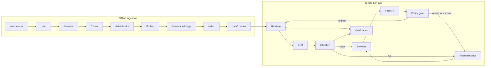
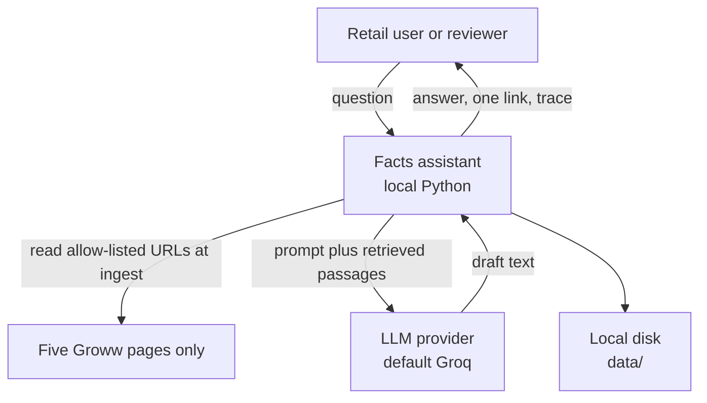
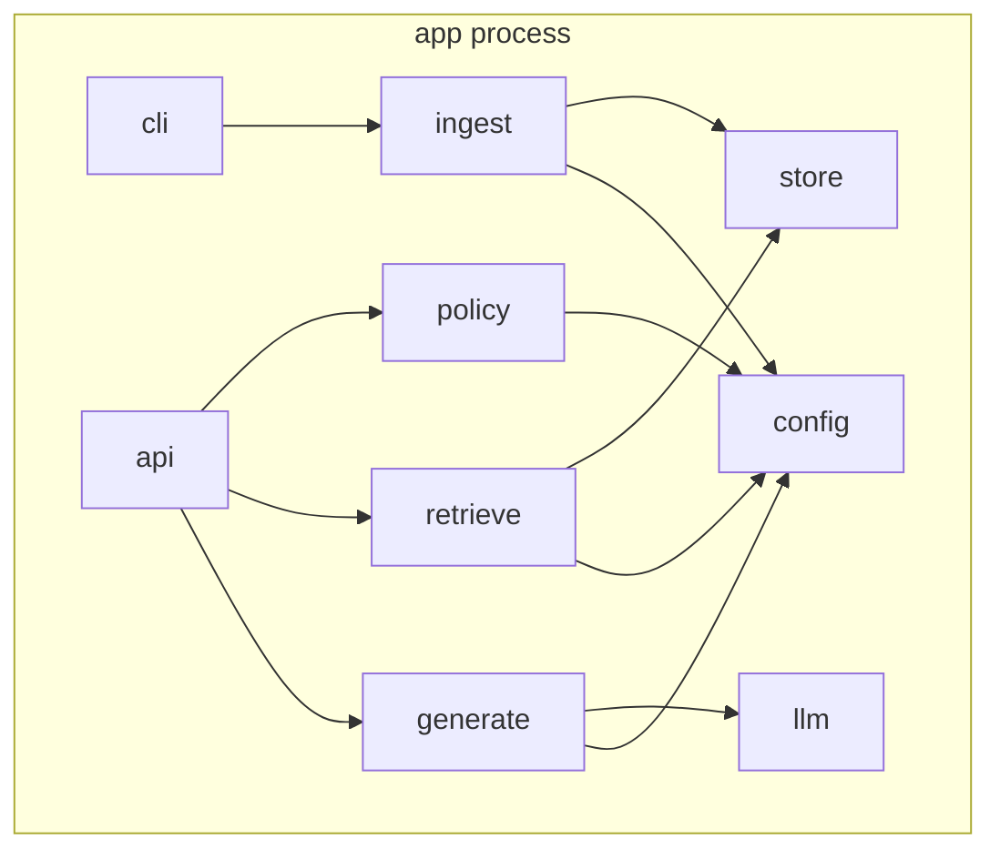
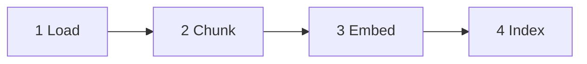
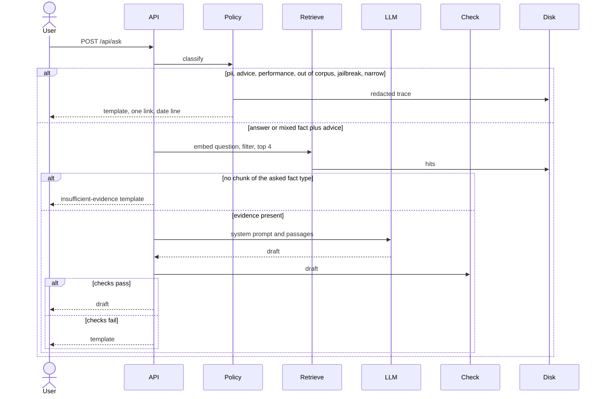

# Architecture

**Groww Mutual Fund Facts Assistant**  
Inspectable, single-process RAG prototype

| | |
| --- | --- |
| Status | Draft for build |
| Version | 1.0 |
| Date | 1 November 2026 |
| Governs | Implementation of [PRD-Groww-MF-Facts-Assistant.md](PRD-Groww-MF-Facts-Assistant.md) |
| Runtime | One local Python process. Ingestion is a CLI. Questions are a single HTTP call. |

This document decides how the system is built. The PRD decides what it may say. Where they disagree, the PRD wins and this file is updated.

---

## 1. Architecture in one page

A reviewer can point at a folder and see each stage of retrieval-augmented generation. Nothing is hidden inside a model call.



Two paths, on purpose.

| Path | Who runs it | Calls the LLM | Writes |
| --- | --- | --- | --- |
| Ingestion | `python -m app.cli <stage>` | No | `data/raw`, `data/chunks`, `data/embeddings`, `data/chroma` |
| Ask | `POST /api/ask` | Only after the policy gate allows an answer | `data/traces/<id>.json` |

The browser never holds an API key. The key stays in the server process environment.

---

## 2. Decisions

| # | Decision | Why |
| --- | --- | --- |
| D1 | One Python process: FastAPI plus a CLI | The corpus is five scheme pages and a short source list. A queue, a vector-database server, and a separate frontend build add failure modes and hide stages. |
| D2 | Policy gate is deterministic and runs before retrieval | Advice, personal data, performance maths, and unknown schemes must not depend on the model behaving. Personal data is never embedded and never sent to Groq. |
| D3 | The LLM is called only for `answer` and `answer_with_refusal` when a matching chunk exists | Weak retrieval plus a fluent model is how invented expense ratios appear. Missing evidence uses a template. |
| D4 | Chunking strategy is `scheme_fact_blocks` | An exit-load slab is one fact. A fixed token window would cut it in half and the model would quote the half. |
| D5 | Embeddings are local MiniLM; generation is a swappable hosted LLM | `sentence-transformers/all-MiniLM-L6-v2` needs no key and makes the embedding stage a file you can open. Generation stays behind `LLM_PROVIDER`. |
| D6 | Chroma is persistent and local | The collection survives a restart, which is the demo. Metadata filters on `scheme_name` and `fact_type` do the precision work that MiniLM will miss on short queries. |
| D7 | Non-secrets live in `config.yaml`. Secrets and provider choice live in `.env` | The problem statement asks for a config file. The PRD asks for env-based provider switching. Env overrides the yaml keys it shares. |
| D8 | A checker can throw away the model draft | The user then sees Appendix B of the PRD, with a real URL and the real fetch date filled in. |
| D9 | Single turn. The server stores no session | A follow-up of “and the exit load?” would borrow the previous scheme from hidden state and cite the wrong page. The client sends one question. |
| D10 | Stage watermark | Re-running a stage deletes that stage and every stage after it, then writes a new watermark. The ask path refuses to run if the watermark is older than the chunks. |

---

## 3. System context



The ask path does not fetch Groww. It reads the index built at ingest. A stale page is a visible `fetched_at` date, which is the honesty mechanism.

The scraper fetches exactly five URLs, listed in `sources/sources.csv`. It does not open links found on those pages. A factsheet, peer-fund, help, SEBI, AMFI, CAMS, or KFin URL that appears in the HTML is not requested. A redirect is saved only when the final URL is still one of those five pages. `groww.in/blog` is never fetched.

---

## 4. Process and modules



| Module | Responsibility |
| --- | --- |
| `app/config.py` | Load `config.yaml`, overlay `.env`, expose one frozen `Settings` object. |
| `app/cli.py` | Commands: `load`, `chunk`, `embed`, `index`, `pipeline`, `ask`. `pipeline` runs the four ingest stages in order. |
| `app/api.py` | `GET /`, `GET /api/health`, `POST /api/ask`. Serves `web/index.html`. |
| `app/policy/classify.py` | Map one question to one action. No model, no vectors. |
| `app/policy/pii.py` | Detect identifiers. Return a redacted question for storage. |
| `app/policy/templates.py` | Fill PRD Appendix B templates. The only place refusal copy is assembled. |
| `app/policy/checker.py` | Accept or reject a draft. |
| `app/ingest/load.py` | Fetch the source list. Write raw body, cleaned text, sidecar. |
| `app/ingest/chunk.py` | `scheme_fact_blocks`. Write `chunks.jsonl`. |
| `app/ingest/embed.py` | MiniLM. Write `embeddings.jsonl`. |
| `app/ingest/index.py` | Upsert Chroma. Record the embedding model on the collection. |
| `app/retrieve/search.py` | Embed the question, filter, retry, return hits. |
| `app/generate/prompt.py` | Read `prompts/system.md` and attach passages. |
| `app/llm/base.py` | `complete(system, user) -> str`. |
| `app/llm/factory.py` | Build the client named by `LLM_PROVIDER`. |
| `app/store/layout.py` | Paths, watermarks, trace writer. |
| `web/index.html` | Chat page: scheme cards, three questions, thread, tab-local history. The mark is `web/logo.png`. |
| `prompts/system.md` | Reviewed prompt. Not buried in Python. |
| `sources/sources.csv` | The only URL allow-list the loader will fetch. |

---

## 5. Repository layout

```
.
├── config.yaml
├── .env.example
├── prompts/
│   └── system.md
├── sources/
│   └── sources.csv
├── app/
│   ├── cli.py
│   ├── api.py
│   ├── config.py
│   ├── policy/
│   ├── ingest/
│   ├── retrieve/
│   ├── generate/
│   ├── llm/
│   └── store/
├── web/
│   └── index.html
├── stitch_groww_rag_chatbot_ui/   Stitch export: two screens plus Mint Financial System
├── eval/
│   ├── gold.jsonl
│   └── sample_qa.md
└── data/                      gitignored
    ├── pipeline.json
    ├── raw/<source_id>/
    ├── chunks/chunks.jsonl
    ├── embeddings/embeddings.jsonl
    ├── chroma/
    └── traces/<trace_id>.json
```

`data/` is gitignored. `sources/`, `prompts/`, `config.yaml`, and `.env.example` are committed. `.env` is not.

---

## 6. Configuration

`config.yaml` holds the pipeline. `.env` holds secrets and the provider. For overlapping keys, the environment wins, so a demo can retarget the model without editing the file that reviewers diff.

```yaml
embedding_model: sentence-transformers/all-MiniLM-L6-v2
embedding_batch_size: 64
chroma_path: data/chroma
chroma_collection: hdfc_mf_facts
chroma_space: cosine
chunk_strategy: scheme_fact_blocks
chunk_max_chars: 800
chunk_overlap_chars: 120
top_k: 4
temperature: 0.1
reasoning_effort: none
llm_provider: groq
llm_model: qwen/qwen3.8-27b
citation_domains:
  - groww.in
  - sebi.gov.in
  - amfiindia.com
  - camsonline.com
  - kfintech.com
blocked_path_prefixes:
  - groww.in/blog
```

Environment variables use the same names in upper snake case (`EMBEDDING_MODEL`, `CHROMA_PATH`, `TOP_K`, `LLM_PROVIDER`, `LLM_MODEL`, `LLM_TEMPERATURE`, `LLM_REASONING_EFFORT`). `LLM_API_KEY` exists only in the environment. If `LLM_PROVIDER=groq` and `LLM_API_KEY` is empty, the process also reads `GROQ_API_KEY`.

`chunk_max_chars` of 800 is the starting overflow limit because MiniLM-L6 was trained on short sequences (about 256 word pieces). A fact block is kept whole even when it exceeds 800 characters. The limit applies only to leftover prose. The actual values used are copied onto every chunk as `strategy_params`.

Scheme identity is configuration, not a prompt trick. Display names and aliases resolve to one canonical `scheme_name`, which is also the Chroma filter value.

| `scheme_name` | Canonical URL slug | Aliases the classifier accepts |
| --- | --- | --- |
| HDFC Large Cap Fund Direct Growth | `hdfc-large-cap-fund-direct-growth` | large cap |
| HDFC Flexi Cap Direct Plan Growth | `hdfc-equity-fund-direct-growth` | flexi cap, hdfc equity fund |
| HDFC ELSS Tax Saver Fund Direct Plan Growth | `hdfc-elss-tax-saver-fund-direct-plan-growth` | elss, tax saver |
| HDFC Mid Cap Fund Direct Growth | `hdfc-mid-cap-fund-direct-growth` | mid cap |

“HDFC equity fund” maps to Flexi Cap because that is the page in the corpus. The answer still uses the display name **HDFC Flexi Cap Direct Plan Growth**, so the user sees the plan they asked about.

---

## 7. Ingestion

Stages run left to right. Each stage reads the previous stage’s files and writes its own. A stage does not call the network except `load`.



### 7.1 Watermark

`data/pipeline.json` is the contract between CLI and API.

```json
{
  "embedding_model": "sentence-transformers/all-MiniLM-L6-v2",
  "embedding_dim": 384,
  "chunk_strategy": "scheme_fact_blocks",
  "collection": "hdfc_mf_facts",
  "stages": {
    "load":  {"status": "ok", "finished_at": "2026-11-01T12:00:00+05:30", "input_hash": "…", "output_hash": "…"},
    "chunk": {"status": "ok", "finished_at": "…", "input_hash": "…", "output_hash": "…"},
    "embed": {"status": "ok", "finished_at": "…", "input_hash": "…", "output_hash": "…"},
    "index": {"status": "ok", "finished_at": "…", "input_hash": "…", "output_hash": "…"}
  }
}
```

Rules:

- `chunk.input_hash` must equal `load.output_hash`, and the same chain through `index`.
- Starting `load` removes `data/chunks`, `data/embeddings`, `data/chroma`, and marks those stages `stale`.
- Starting `chunk` removes embeddings and Chroma. Same pattern down the line.
- `GET /api/health` returns 503 unless all four stages are `ok` and `embedding_model` equals the current config. The UI shows “Index is not ready” and does not call the provider.

`output_hash` for load is the hash of the sidecar list. For chunk it is the hash of `chunks.jsonl`. For embed it is the hash of chunk ids plus model name plus dimension, not the hash of every float.

### 7.2 Stage 1 — Load

Input is `sources/sources.csv` only. Columns: `id`, `url`, `publisher`, `page_type`, `scheme_name`, `why_included`. The file has exactly these five rows, and the command exits if the count is anything else:

| id | url |
| --- | --- |
| `hdfc-amc` | https://groww.in/mutual-funds/amc/hdfc-mutual-funds |
| `hdfc-large-cap` | https://groww.in/mutual-funds/hdfc-large-cap-fund-direct-growth |
| `hdfc-flexi-cap` | https://groww.in/mutual-funds/hdfc-equity-fund-direct-growth |
| `hdfc-elss` | https://groww.in/mutual-funds/hdfc-elss-tax-saver-fund-direct-plan-growth |
| `hdfc-mid-cap` | https://groww.in/mutual-funds/hdfc-mid-cap-fund-direct-growth |

`page_type` is `amc` for the first row and `scheme` for the other four. The scraper requests each URL once. It does not crawl links inside the page.

For each row, in order:

1. Reject the URL if the host is not in `citation_domains`, or the host plus path starts with a blocked prefix.
2. HTTP GET with a desktop browser user-agent and a 20-second timeout. Follow redirects only if the final host is still allowed.
3. On any failure, write the sidecar with `status: failed` and continue. A failed scheme stays in the corpus as uncovered. Ask-time behaviour for that scheme is the insufficient-evidence template.
4. On success, strip `script`, `style`, `nav`, `footer`, and cookie-consent nodes. Keep main text.
5. Write three files:
   - `data/raw/<id>/page.html` — response body
   - `data/raw/<id>/text.txt` — cleaned visible text
   - `data/raw/<id>/meta.json` — sidecar

Sidecar fields: `source_id`, `url`, `final_url`, `title`, `page_type`, `scheme_name`, `fetched_at` (date only, `YYYY-MM-DD`), `fetched_at_iso`, `http_status`, `content_hash` (SHA-256 of `text.txt`), `status`.

Request headers are not stored. The loader sends no cookies and no authorization header. A SID or factsheet URL found in the page JSON is stored as text on the scheme chunk. It is not added to `sources.csv` and it is not fetched.

### 7.3 Stage 2 — Chunk

Strategy id: `scheme_fact_blocks`. The CLI refuses to run if `config.yaml` names anything else. Size tweaks do not require a new strategy id.

**Scheme pages** (`page_type=scheme`). The parser looks for labelled fact blocks in the cleaned text. One block becomes one chunk, even if it is longer than `chunk_max_chars`.

| `fact_type` | What the block must contain |
| --- | --- |
| `expense_ratio` | The ratio label and its value |
| `exit_load` | The full slab, including every holding-period clause |
| `minimum_sip` | The SIP minimum |
| `minimum_lumpsum` | The lump-sum minimum, and only if the page shows one |
| `lock_in` | The lock-in label and value. ELSS pages have a statutory lock-in. Other scheme pages get a chunk only when the page states a lock-in or explicitly states there is none |
| `riskometer` | The risk label as printed |
| `benchmark` | The benchmark name |
| `investment_objective` | The objective paragraph |
| `category` | The fund category |
| `factsheet_link` | The outbound factsheet URL found on the page |

A block that cannot be found is skipped. It is not invented. The chunk log lists missing fact types per scheme so Phase 2 of the PRD can be checked by reading a file.

**AMC page.** Heading-level chunks with `fact_type=amc_overview`. Sections longer than `chunk_max_chars` split on blank lines, then sentences, with `chunk_overlap_chars` of overlap. A split never starts in the middle of a word.

**Help pages.** One chunk per heading or numbered step group, `fact_type=statement_download`. A step is not cut by the character limit. If a single step exceeds the limit, that step is its own chunk anyway.

**Regulator and factsheet pages.** Heading-level chunks. `fact_type` is `investor_education` or `factsheet`. These chunks exist so refusal templates and “where is the factsheet?” have a retrieved URL. They are not a back door for quoting returns. The generator does not receive `factsheet` chunks on a performance question, because that question never reaches generation.

Chunk record, one JSON object per line in `data/chunks/chunks.jsonl`:

```json
{
  "chunk_id": "hdfc-large-cap:expense_ratio:0",
  "source_id": "hdfc-large-cap",
  "source_url": "https://groww.in/mutual-funds/hdfc-large-cap-fund-direct-growth",
  "title": "HDFC Large Cap Fund Direct Growth",
  "amc": "HDFC Mutual Fund",
  "scheme_name": "HDFC Large Cap Fund Direct Growth",
  "plan": "Direct",
  "option": "Growth",
  "fact_type": "expense_ratio",
  "text": "…",
  "fetched_at": "2026-11-01",
  "strategy": "scheme_fact_blocks",
  "strategy_params": {"chunk_max_chars": 800, "chunk_overlap_chars": 120}
}
```

`chunk_id` is `{source_id}:{fact_type}:{n}` and is stable across reloads of unchanged text. `scheme_name` is an empty string on AMC, help, and regulator chunks so Chroma metadata stays a string. `plan` and `option` are `Direct` and `Growth` on scheme chunks, and empty strings elsewhere.

If a scheme page has no separable labels, the parser falls back to heading-level chunks for that page only, sets `strategy` to `scheme_fact_blocks+headings`, and the README records the exception. A pure fixed-width split of scheme facts is not a valid fallback.

### 7.4 Stage 3 — Embed

- Library: `sentence-transformers`.
- Model id from config. Loaded once per process.
- `normalize_embeddings=True`, which is what cosine search expects.
- Batch size from config, default 64.
- Dimension for `all-MiniLM-L6-v2` is 384. The stage reads the vector length from the model and writes it to the watermark. It does not hard-code 384 as the only legal model, so a config change to another sentence-transformers model still runs. Query time compares the live dimension to the watermark.
- Output: `data/embeddings/embeddings.jsonl`, one row per chunk, written before the Chroma upsert.

```json
{
  "chunk_id": "hdfc-large-cap:expense_ratio:0",
  "model": "sentence-transformers/all-MiniLM-L6-v2",
  "dim": 384,
  "vector": [0.01, 0.02],
  "metadata": {"source_url": "…", "scheme_name": "…", "fact_type": "expense_ratio", "fetched_at": "2026-11-01"}
}
```

The vector in the example is truncated. The file stores the full vector. User questions are not written here.

### 7.5 Stage 4 — Index

- Client: persistent Chroma at `chroma_path`.
- Collection name from config. Created with metadata `hnsw:space=cosine`.
- Collection metadata also stores `embedding_model` and `embedding_dim`.
- Upsert id is `chunk_id`. A second index of the same chunks replaces rows instead of duplicating them.
- Metadata stored on the point: `source_id`, `source_url`, `scheme_name`, `fact_type`, `fetched_at`, `plan`, `option`, `amc`, `title`. Document text is the chunk `text`.
- After upsert, a smoke query filters `fact_type=expense_ratio` for each of the four scheme names and asserts one hit. Failure exits non-zero and leaves the index stage `failed`.

---

## 8. Ask path

`POST /api/ask` with `{"question": "<string>"}`. The body is required, trimmed, and limited to 500 characters. There is no conversation id.



### 8.1 Policy gate

Order is fixed. The first match wins, except mixed fact-plus-advice, which is its own action.

| Step | Test | Action | LLM | Retrieval |
| --- | --- | --- | --- | --- |
| 1 | PAN, Aadhaar-like 12 digits, email, phone, or an OTP-like number next to the words OTP, PAN, folio, or account | `refuse` / `pii` | No | No |
| 2 | Jailbreak phrasing (“ignore your rules”, “act as an advisor”, “developer mode”) | `refuse` / `jailbreak` | No | No |
| 3 | Names a scheme that is not one of the four and not an alias | `refuse` / `out_of_corpus` | No | No |
| 4 | Asks for returns, CAGR, alpha, ranking, or “which is best” | `refuse` / `performance` | No | No |
| 5 | Advice or allocation, and no in-scope fact | `refuse` / `advice` or `portfolio` | No | No |
| 6 | In-scope fact and advice in the same question | `answer_with_refusal` | Yes, if a chunk matches | Yes |
| 7 | Statement download | `answer` | Yes, if a chunk matches | Yes, `fact_type=statement_download` |
| 8 | AMC overview, no specific scheme fact | `answer` | Yes, if a chunk matches | Yes, `fact_type=amc_overview` |
| 9 | Fact type known, scheme missing | `narrow` | No | No |
| 10 | Fact type and scheme known | `answer` | Yes, if a chunk matches | Yes |

Detection is keyword and alias based, in `app/policy/classify.py`, with the lists kept next to the scheme table so they can be reviewed. The classifier does not call an LLM. Ambiguous overlap (“riskometer” contains no advice words) falls through to step 10.

`narrow` returns the clarifying template, the four display names, the HDFC AMC overview URL, and that page’s `fetched_at`. It does not guess.

PII handling:

- The raw question is held in memory only for the detector.
- The trace stores `question_redacted` with identifier spans replaced by `[redacted]`, plus `event: pii_refused`.
- The raw string is not logged, not embedded, and not sent to the provider.
- The reply uses the PII template and does not echo the identifier.

### 8.2 Retrieval

Used for `answer` and `answer_with_refusal` only.

1. Confirm the watermark model equals the loaded MiniLM instance. On mismatch, return 503 and skip the provider.
2. Embed the question locally with the same normalize flag as ingest.
3. Build filters from the classifier:
   - Scheme fact: `scheme_name` equals the canonical name, and `fact_type` equals the asked type.
   - Two fact types in one question (riskometer and benchmark): two filtered queries, then merge by `chunk_id`.
   - Statement or AMC: filter on `fact_type` only.
4. Query Chroma for `top_k` (default 4) under that filter.
5. If the fact-type filter returns zero hits, retry once with the scheme filter only.
6. If the scheme filter returns zero hits, retry once with no metadata filter.
7. If a retry dropped a filter, the trace records `filter_relaxed: true`. The generator is told the relaxation happened, and the answer must name the page that was actually used.
8. A hit counts as evidence only when its `fact_type` equals the asked type, or the retry text contains the fact label. Otherwise the action becomes `insufficient_evidence` and the provider is not called.

Hits saved on the trace, in rank order: `chunk_id`, `chroma_distance`, `fact_type`, `scheme_name`, `source_url`, `fetched_at`, `text`. The distance is stored as Chroma returns it for cosine space. The UI label is “Chroma distance” so a reviewer does not read it as a probability.

### 8.3 Generation

The prompt file `prompts/system.md` is read at request time, so an edit does not require a code change. Passage text is appended by code, not pasted into the file by hand. The file follows the PRD order: role, allowed facts, bans, weak-retrieval behaviour, output contract.

The user message the provider sees:

```
Question: …
Action: answer | answer_with_refusal
Filter relaxed: true | false

Passages:
[1] url=… scheme=… fact_type=… fetched_at=…
<chunk text>
```

Provider call:

| Setting | Value |
| --- | --- |
| Temperature | 0.1 |
| Reasoning effort | `none` on Groq Qwen. Omitted for providers that have no such parameter |
| Tools, JSON mode, web search | Off |
| Max output tokens | 256 |

`app/llm/factory.py` maps `LLM_PROVIDER`:

| Provider | Client |
| --- | --- |
| `groq` | Groq OpenAI-compatible chat completions. Model default `qwen/qwen3.8-27b` |
| `gemini` | Google GenAI SDK |
| `openai` | OpenAI SDK |
| `anthropic` | Anthropic SDK |
| `mistral` | Mistral SDK |

Each adapter implements `complete(system: str, user: str) -> str` and returns the visible text only. Thinking traces, if a provider attaches them, are dropped before the checker. A provider error becomes the fixed UI sentence from the PRD and a trace field `provider_error: true`. The exception text is logged server-side with the API key redacted, and is not returned to the browser.

There is no automatic fallback to a second model. If the configured id is rejected, the request fails and the operator changes `LLM_MODEL`.

### 8.4 Checker

The checker runs on every draft. Failure discards the draft.

| Check | Pass condition | On failure |
| --- | --- | --- |
| One link | Exactly one `http` or `https` URL in the draft | Template |
| Allow-list | That URL’s host is allowed, the path is not `groww.in/blog`, and the URL is in `sources.csv` or equals a retrieved chunk’s `source_url` | Template |
| Date line | Last line matches `Last updated from sources: YYYY-MM-DD.` | Template |
| Date truth | That date equals the cited source’s `fetched_at` | Replace the date with the sidecar date if the rest of the draft passed. If more than one check failed, use the template |
| Length | At most three sentences before the date line | Template |
| Grounding | Every number, percent, and rupee amount in the answer also appears in the cited chunk’s text | Template. Years inside the date line are ignored |
| Mixed refusal | When the action is `answer_with_refusal`, the draft contains “Facts only.” and does not contain a buy, sell, or hold recommendation | Template |
| Pure refusal never generated | Unreachable for template actions, because those actions do not call the model | — |

The template chosen on failure:

- `answer_with_refusal` that fails grounding uses the insufficient-evidence template. A wrong number is worse than a refusal of the advice.
- `answer` that fails uses insufficient evidence, linked to the canonical scheme page, or the help page for statement questions.
- Performance and advice templates are used on the policy-gate path, not as a disguise for a failed factual draft.

### 8.5 Trace

One file per request: `data/traces/<utc timestamp>-<short id>.json`.

```json
{
  "trace_id": "20261101T063000Z-ab12",
  "action": "answer",
  "refusal_reason": null,
  "question_redacted": "What is the expense ratio of HDFC Large Cap Fund Direct Growth?",
  "scheme_name": "HDFC Large Cap Fund Direct Growth",
  "fact_types": ["expense_ratio"],
  "filters": {"scheme_name": "HDFC Large Cap Fund Direct Growth", "fact_type": "expense_ratio"},
  "filter_relaxed": false,
  "top_k": 4,
  "hits": [],
  "llm_called": true,
  "llm_provider": "groq",
  "llm_model": "qwen/qwen3.8-27b",
  "draft": "…",
  "checker": {"passed": true, "failures": []},
  "final_text": "…",
  "source_url": "https://groww.in/mutual-funds/hdfc-large-cap-fund-direct-growth",
  "fetched_at": "2026-11-01"
}
```

`hits` uses the retrieval fields from §8.2. Provider payloads, authorization headers, and raw PII are not fields in this object.

### 8.6 HTTP response

```json
{
  "action": "answer",
  "answer": "…\nSource: https://groww.in/…\nLast updated from sources: 2026-11-01.",
  "source_url": "https://groww.in/…",
  "fetched_at": "2026-11-01",
  "trace_path": "data/traces/20261101T063000Z-ab12.json",
  "inspector": {
    "action": "answer",
    "llm_called": true,
    "filters": {},
    "hits": []
  }
}
```

`inspector.hits` includes `chunk_id`, `chroma_distance`, `fact_type`, and `source_url`. It omits full chunk text if that text would duplicate a long page into the browser. The trace file keeps the text. The inspector shows the trace path so a reviewer can open it.

---

## 9. UI

`web/index.html` is one static page. FastAPI serves it at `/` and the Groww mark at `/logo.png`. There is no frontend build and no account. The Stitch export in `stitch_groww_rag_chatbot_ui/` is the layout reference. The shipped page does not copy its placeholder scheme names, comparison prompts, account avatar, or “trained on SID” line.

The page is a chat. The left rail stays put. The thread scrolls on its own. “Choose a scheme” stays fixed above the thread. The suggested questions, the input, and the disclaimer stay fixed under it.

### Layout

- **Rail.** The mark is a `#00D09C` arrow that rises, dips once, and points to the upper right. Beside it, “Mutual Funds” is `#00D09C` and “Knowledge Assistant” is `#171A2C`. A square-with-a-bar control collapses the rail to the logo. Clicking the logo opens it again. On a narrow window the logo opens the rail as an overlay. “New chat” is left-aligned. “Recent chats” lists questions from this browser tab, newest first, with no “This tab” line. Choosing one scrolls to that turn. It does not ask again.
- **Empty chat.** The line “What would you like to know today?” is centered in the chat area.
- **Thread.** The question sits on the right, in the pale mint fill, with green text. The answer sits on the left, on a white card: the reply, one source link, then the fetch-date line. “Facts only.” is removed from the text shown in the bubble. The API response may still start with that phrase.
- **Suggested questions.** Three questions in one row, in the chat area, not inside the input. They do not scroll with the thread. Each scheme card names the selected scheme, for example “What is the lock-in period for HDFC ELSS Tax Saver Fund Direct Plan Growth?”. HDFC AMC Overview shows “About HDFC Mutual Fund?”, the SEBI-approval question, and the CEO question. An X removes that question until New chat and does not reveal a fourth. ELSS shows lock-in period, expense ratio, and minimum SIP. Mid Cap and Flexi Cap show exit load, expense ratio, and benchmark. Large Cap shows expense ratio, exit load, and benchmark.
- **Asking.** A click or a typed question is one `POST /api/ask`. If the text does not already name a scheme, and it is not a capital-gains or fund-house question, the page appends `for {selected scheme}?` before sending. With HDFC AMC Overview selected, a typed question that does not already name the fund house is sent as `for the HDFC Mutual Fund fund house?`. The bubble shows the words on the card, or the typed words. The thread is kept in `sessionStorage` under `groww-rag-thread`, up to 20 turns. New chat clears that thread and restores the three questions.
- **Scheme menu.** “Choose a scheme” sits at the top of the chat and does not scroll. The five choices are cards, with “HDFC AMC Overview” first, then the four Direct Growth schemes. A click anywhere on that bar opens the cards. An arrow, or another click on the bar, closes them. Choosing a scheme closes them too. The open and close ease rather than snap. Choosing HDFC AMC Overview asks about the fund house, not one of the four schemes.
- **Input.** Its own field. Placeholder: “Ask Groww”. The send control uses the same pale mint as New chat.
- **Disclaimer.** One centered line under the field, not inside it, with a warning icon in the same grey as the words: “Facts only. No investment advice. Check the linked page before you act.”

There is no “How this answer was produced” panel.

### Colour and type

The green is `#00D09C`. Pale fills stay `#EAF9F5` so the words sit on a light card.

| Role | Value |
| --- | --- |
| Green text, borders, and icons | `#00D09C` on Mutual Funds, New chat, links, the send icon, selected scheme text, and the rising arrow |
| Pale mint fill | `#EAF9F5` on New chat, the user’s bubble, the send button, and the selected scheme card |
| Text | `#171A2C` for Assistant and titles, `#44475B` for body, `#7C7E8C` for the disclaimer and secondary lines |
| Canvas and card | `#F8F8F8` canvas, `#FFFFFF` card, 1px border `#E9E9EB` |
| Error | `#EB5B3C` is reserved for an error state. It is not a trade colour |
| Type | Inter. Chat copy is 14px. “Mutual Funds” is green at weight 700. “Knowledge Assistant” is dark at weight 600 |

Motion is a short ease on the rail width and on a new message. It is turned off when the system asks for reduced motion.

### What the screens must not copy

| On the Stitch screen | On this page |
| --- | --- |
| “HDFC Top 100 (Large Cap) Fund” | HDFC Large Cap Fund Direct Growth |
| “HDFC Mid Cap Opportunities Fund” | HDFC Mid Cap Fund Direct Growth |
| “HDFC Flexi Cap Fund” | HDFC Flexi Cap Direct Plan Growth |
| “HDFC ELSS Tax Saver Fund” | HDFC ELSS Tax Saver Fund Direct Plan Growth |
| “Flexi Cap vs Large Cap TER” | Not a suggested question |
| “Direct vs Regular plan” | Not a suggested question |
| “Trained on official Scheme Information Documents” | The disclaimer says answers quote the loaded pages |
| Avatar “JD” and an account menu | Omitted. There is no login |
| Four or five full-name question cards | Three short questions. The selected scheme is added on send |

Suggested questions ask for one fact. They do not ask which scheme is better. A capital-gains question typed by the user is sent as written, without a scheme name attached.

If the index is not ready, the page says so. A provider error uses the fixed sentence: “The assistant could not complete that question. Your question was not sent to a fund-recommendation system.”

---

## 10. Security boundaries

| Boundary | Rule |
| --- | --- |
| Secrets | `LLM_API_KEY` and `GROQ_API_KEY` are read from the environment inside the provider adapter. They are not written to traces, watermarks, or the browser. |
| Corpus writes | Only the loader, and only to URLs in `sources.csv` that pass the domain check. |
| Vector store writes | Only chunk embeddings. The ask path opens Chroma read-only. |
| Personal data | Detector runs first. Redacted trace. Template reply. No provider call. |
| Model reach | The model receives the system prompt and the retrieved passages. It has no tool that can fetch the web or read `data/raw`. |
| Citation reach | The checker drops any URL outside the allow-list, including a URL the model invents on an allowed host if that URL was not in the source list or the retrieved chunks. |
| Dependency posture | Ingest libraries are HTTP, an HTML parser, sentence-transformers, and Chroma. The API adds FastAPI. Provider SDKs are imported by the adapter that is configured, so an unused provider is not required to boot. |

This process is a local demo. It is not an investment-advisory service, and the UI must not grow a transaction control. Binding the server to `127.0.0.1` is the default. Binding a public interface is a hosting decision (PRD open point 4) and requires the key to remain on the server.

---

## 11. Failure behaviour

| Failure | What the user gets | What is saved |
| --- | --- | --- |
| Source page HTTP error at ingest | Nothing at ingest time. Later questions for that scheme get insufficient evidence | Sidecar `status: failed` |
| Missing fact block | Insufficient evidence once they ask | Chunk log lists the missing `fact_type` |
| Embedding model ≠ index model | “Index is not ready.” | No trace of a provider call |
| Zero evidence after the retry | Insufficient-evidence template and the canonical URL | Trace with `llm_called: false` and the hits that were rejected |
| Provider timeout or 4xx/5xx | The fixed completion-error sentence | `provider_error: true`, no stack in the JSON response |
| Checker rejection | The template for that failure | Both `draft` and `final_text`, plus `checker.failures` |
| PII in the question | PII template | Redacted question only |

Timeouts: load uses 20 seconds per URL; the provider call uses 30 seconds. The p50 under 8 seconds and p95 under 15 seconds in the PRD are measured on the ask path with a warm MiniLM process. Cold start of the embedding model is excluded from that bar and mentioned in the README.

---

## 12. How a reviewer walks the demo

1. Open `sources/sources.csv` and count the rows.
2. Run `python -m app.cli pipeline` and open, in order, `data/raw`, `data/chunks/chunks.jsonl`, `data/embeddings/embeddings.jsonl`, and `data/pipeline.json`.
3. Ask the expense-ratio example. Confirm the number is in the cited chunk and the URL is the Large Cap scheme page.
4. Ask “Should I buy HDFC Flexi Cap?” and confirm `llm_called` is false in the trace file.
5. Paste a PAN and confirm the trace file does not contain it.
6. Open the trace file named in the response and match the hit ids to lines in `chunks.jsonl`. The page does not show an inspector.

`eval/sample_qa.md` is produced by a script that runs 5–10 questions through `POST /api/ask` and writes the real `final_text` and `source_url`. It is not authored by hand.

---

## 13. What this architecture leaves out

Catalogue coverage beyond HDFC Direct Growth, account login, scheduled scraping, multi-turn memory, a hosted vector database, and a second model hoping to “double check” the first. Precision comes from the fact-block chunks, the metadata filter, and the checker.

A customer release would remove the stage inspector, put the process behind Groww’s own auth and logging review, and replace the local Chroma directory with an operated store. None of that is part of this prototype, and the module boundaries above are what make that removal a deletion rather than a rewrite. The policy gate, the templates, and the checker would stay.

---

## 14. Document history

| Version | Date | Change |
| --- | --- | --- |
| 1.3 | 9 November 2026 | UI section updated for the top scheme cards, the Groww circle mark, and green `#00D09C`. |
| 1.2 | 1 November 2026 | UI section rewritten to the shipped chat page: rail, three short questions, scheme menu, and the New Chat green. |
| 1.1 | 1 November 2026 | UI section now follows the Stitch export and the Mint Financial System. Scheme names and the single-question ask path stay as specified. |
| 1.0 | 1 November 2026 | Architecture for the inspectable local RAG prototype described in the PRD. |
